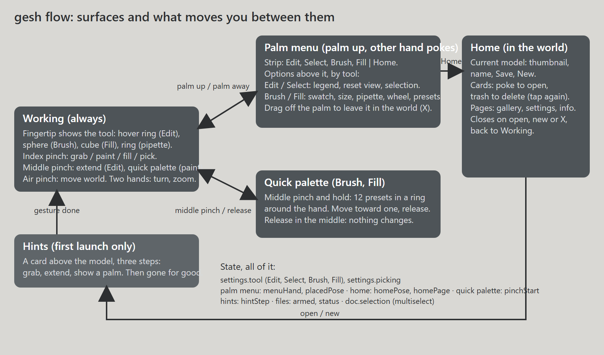

# gesh UI: flow and surfaces

Status: implemented (steps 1-5 below), except the Select tool and its
selection row, which wait for plans/multiselect.md. Until then the strip has
Edit, Brush, Fill and Home, sized to fill the row. Built differently from the
text: a card's trash button sits in its label row instead of overlapping the
thumbnail (overlapping buttons would both take the poke), and Home's page
buttons sit under the status line rather than pinned to the bottom.

Sizes are meters. Colors are gamma space; "accent" is `GTheme.ACCENT`
(HSV 0.58, 0.55, 0.85), panel and buttons stay StereoKit's derived slate.
Mockups are in `plans/mockups/` (`overview.png` has all flat and scene
mockups on one sheet, `storyboard.png` walks the three main flows,
`flow.png` is the state diagram). `mockups.html` is the single source;
`render.sh` re-renders everything with headless Edge.

## 1. What the app asks of the hands, and what Quest 3 tracking allows

Everything below is justified against these five facts:

1. **Fatigue.** Arms held at chest height tire in minutes. UI must come to
   the hand (palm, fingertip) or sit where the arm already is; reaching to a
   fixed spot in the world is for rare actions only.
2. **Occlusion.** Tracking is best with the palm toward the headset or
   sideways, worst when one hand covers the other or fingers point at the
   cameras. A poke at UI 6 cm in front of the other palm is a good case;
   fine pinches with the palm turned away are a bad one.
3. **Tracking loss.** Hands drop out at the edge of view and come back with
   a jump. Nothing may toggle on a momentary pose; menus that live on a hand
   must simply vanish and reappear without side effects.
4. **Accidental gestures.** Relaxed fingers pinch. The reliable deliberate
   gestures are: thumb to index, thumb to middle, and a flat open palm
   facing the head. Ring and little finger pinches are not reliable.
5. **Precision.** Direct pokes at 2.5 cm or larger targets are reliable;
   pinch position has about 1 cm of jitter. Choosing by *direction of
   motion* is more robust than choosing by exact position.

The mesh gestures are taken: index pinch grabs, middle pinch extends, an
index pinch in the air moves the world, two hands turn and zoom. What's free:
the middle pinch while a paint tool is active, the palm pose, and pokes.

## 2. The flow



```
                 palm up                       Home button
  WORKING  <--------------->  PALM MENU  ------------------>  HOME (in world)
  always      palm away       strip + options                 gallery / settings / info
    ^                                                              |
    |  middle pinch (Brush/Fill), release                          | open / new / X
    +----------------------->  QUICK PALETTE                       |
    |                                                              |
    +<-------------------------------------------------------------+
    ^
    |  first launch only: HINT card above the model, 3 steps, then gone
```

Four surfaces, each with one job:

| Surface | Where | Opens | Closes | Holds |
|---|---|---|---|---|
| **Fingertip** | index tip, both hands | always | never | what the next pinch will do: hover ring (Edit/Select), sphere (Brush), cube (Fill), ring (pipette) |
| **Palm menu** | 6 cm in front of an open palm | palm facing head, fingers straight | palm away (or stays, when dragged off) | **tool strip** + the current tool's **options** |
| **Quick palette** | ring around the pinching hand | middle pinch while Brush or Fill | release | 12 preset colors |
| **Home** | 0.55 m in front of the head | strip's Home button | X, open, new | current model (name, save, new), saved models as cards, settings page, info page |
| **Hints** | 6 cm above the model | first launch (no saved files) | each gesture done; after the palm is shown, forever | one line + icon |

Why this shape:

- **The strip is the tool, the panel is the tool's options.** Today a tab
  picks a tool *and* the panel has its own tool radios, and Edit's panel is
  18 cm of nothing. Now `settings.tool` is the only state: the strip
  highlights it, the options panel is chosen by it, the fingertip draws it.
  One truth, three views. Panels are as tall as they need to be (Edit 0.13,
  Paint 0.215), anchored at the palm and growing upward, so a short panel is
  not an empty one.
- **Color mid-stroke without turning the palm.** Painters flick to a color
  constantly. The middle pinch is unused while painting, it is a deliberate
  gesture (fact 4), and choosing by direction of hand motion with a 2 cm
  dead zone survives jitter and accidental taps (fact 5). The full palette
  (wheel, brightness, size, pipette) stays on the palm; the ring is the fast
  path for the 12 presets.
- **Files are a place, not a tab.** Opening or saving is rare and wants
  room: a real thumbnail you can recognize, and the current model's name and
  state next to the saved ones. Home sits in the world, where a 46 cm panel
  can live for the ten seconds you need it, and it closes itself once you've
  opened something, so it never costs the palm any space. Settings and info
  are rare too, so they are pages of Home, not strip slots.
- **Hover before pinch.** The biggest edit-mode frustration is a pinch that
  misses a vertex and drags the world instead. A ring on the part the
  fingertip would grab tells you *before* committing. It costs nothing new:
  `GetClosestPart` already runs for Fill.
- **Teach by doing, once.** Gestures aren't discoverable. One hint card at a
  time, above the model, advancing as the gesture is performed. Shown only
  when there are no saved files at launch, so returning users never see it,
  with no flag to persist.

### Alternatives rejected

- **Per-hand tools** (left edits, right paints). Doubles what the user must
  remember, the fingertip indicator would need two meanings, and the off
  hand is already the palette hand. Both hands keep the same tool; lefties
  get symmetry for free.
- **Radial menu for tools.** Tool changes are infrequent; wedges with icons
  are harder to hit than 3 cm palm buttons; and a radial needs a free
  gesture, of which there is one, better spent on colors.
- **Wrist (watch) menu.** The back of the hand is comfortable to hold, but
  offers 6 cm of surface, and the palm trigger is already tuned and
  deliberate. Noted as a later option for the strip alone.
- **Tool belt / body-anchored UI.** No body tracking, so the belt drifts
  with head yaw; looking down while seated is awkward; reaching to the waist
  with a tracked hand often leaves the camera view (fact 3).
- **Contextual popups on mesh parts.** Parts are small and crowded; a popup
  would hide the work. The hover ring is the contextual UI.
- **Hiding the model while Home is open.** Simpler to leave it; you can see
  what you're about to replace, and cards carry their own thumbnails.
- **Gestures for undo or reset view.** No undo exists yet; a two-hand
  "clap" or fist is exactly the kind of pose fact 3 and 4 warn about.
  Reset view is a button in the Edit panel. Undo, when it comes, gets a
  button there too.
- **Dropping explicit Save for autosave-only.** Autosave stays as the
  safety net (it already exists), but naming and keeping a version is a
  deliberate act users expect to see, and the thumbnail is taken at save.

## 3. Surfaces

### 3.1 Fingertip (always)

Mockups: `fingertips.png`, `scene-hover.png`.

| Tool | Index tip shows | Size |
|---|---|---|
| Edit, Select | accent ring (`GIcon.Ring`, billboarded quad, or `Mesh.Sphere` unlit at alpha 0.25) on the point of the nearest part within `grabRadius`: the vertex, the edge midpoint, or the face centroid. Nothing when nothing is in reach. Hidden while pinching (the part itself moves). | 0.016 ring, 0.024 glow |
| Brush | sphere, brush color, alpha 0.5 (as now) | `brushRadius * 2` |
| Fill | cube, brush color, alpha 0.5 (as now) | 0.025 |
| pipette armed | ring in the color under the tip, or gray | 0.02 |

Selected parts (multiselect) draw accent instead of black, as planned.

### 3.2 Palm menu

Mockups: `panel-edit.png`, `panel-select.png`, `panel-brush.png`,
`panel-fill.png`, `panel-pick.png`, `panel-placed.png`, `scene-palm.png`.

```
 +------------------------------------------+   options panel, 0.19 wide,
 |  options for settings.tool               |   height by tool (below)
 +------------------------------------------+
            gap 0.008
 +------------------------------------------+
 | [hammer] [dashed] [brush] [drop] | [grid]|   strip 0.19 x 0.047
 +------------------------------------------+   buttons 0.0308, Home after a 1 mm bar
```

- **Trigger and placement**: unchanged (`IsPalmShown`, `PalmPose`). The
  strip's bottom sits at the palm's bottom; `PalmPose` takes the current
  panel height so the strip never moves when the panel changes.
- **Strip**: four tool radios, Edit (hammer), Select (dashed square), Brush,
  Fill (drop), then a 0.001 x 0.0308 separator bar (`GDraw.Shape(Square)`
  in `#6a7074`), then **Home** (four-squares icon) as a `ButtonImg`. Button
  size `TAB = (0.19 - 2*margin - 4*gutter) / 5 = 0.0308`. The active tool
  is the one accent button (`GTheme.Colored(ACCENT, ...)`).
- **Dragging off the palm** works as now; the close badge (`ButtonRound`,
  0.028) sits on the options panel's top right corner, not the strip.
- **Pipette is not a tool.** It's `settings.picking`, a bool: while set,
  the tip shows the ring, the next index pinch on the mesh sets
  `brushColor` and clears it, and the tool (Brush or Fill) is untouched.
  `GTool.Pick` goes away, and so does the "which tool to return to"
  question.

**Edit options** (0.19 x 0.13):

```
 | (o)  Pinch: grab. Drop on a vertex to merge     |  legend: 0.02 icon + text, LineHeight rows
 | (+)  Middle pinch: pull out a new part          |
 | <+>  Pinch air: move. Two hands: turn, zoom     |
 | [ (+) Reset view ]                              |  0.032 high, auto width
```

The third line says "Two hands in the air: move, turn, zoom" when air
navigation is off (already implemented).

**Select options** (0.19 x 0.13): legend lines "Pinch and sweep: select",
"Start on selected: deselect", air line as above; then the same row with
Reset view at the left and, only while the selection is non-empty,
`"{n} selected"` and `[x Clear]` (0.032 high) at the right. Depends on
plans/multiselect.md; until then Select shows the legend only.

**Brush / Fill options** (0.19 x 0.215):

```
 | (#)  [=====o================]  [pipette] |  swatch 0.032 | size slider | 0.032 button
 |        ( wheel 0.10 )   | bar 0.022 |     |  pair centered
 | [ ][ ][ ][ ][ ][ ]                        |  presets 0.0248, 2 x 6
 | [ ][ ][ ][ ][ ][ ]                        |
```

- Swatch: `GDraw.Shape` in `brushColor`, shape mirrors the fingertip:
  Brush = disc with diameter `lerp(0.010, 0.032, (brushRadius - 0.005) /
  0.055)`; Fill = square 0.028; picking = ring 0.028. (Already built as the
  row-end swatch; it moves to the row start.)
- Size slider full width between swatch and pipette; `PushEnabled(tool ==
  Brush && !picking)`.
- Pipette button: accent while `picking`.
- Wheel, brightness bar, presets: unchanged, pair centered with `HSpace`.

### 3.3 Quick palette

Mockups: `radial.png`, `scene-radial.png`.

- **Opens** when a hand starts a middle pinch while `tool is Brush or Fill`,
  that hand is not the menu hand and is not touching UI. The pinch point at
  that moment is the center, `pinchStart`.
- **Draws** 12 preset discs (0.022, `GDraw`-style unlit quads, layer by
  index) on a ring of radius 0.06 around `pinchStart`, in a plane facing
  the head (`Quat.LookAt(center, head)`), preset 0 at the top, clockwise. A
  0.018 disc in the current color marks the center.
- **Hover**: `d = pinchPos - pinchStart` projected onto the ring plane. If
  `|d| < 0.02` nothing is hovered. Otherwise the preset whose angle is
  nearest `atan2(d)` is hovered: drawn at 0.0275 with a white ring
  (`GIcon.Ring`, layer above). A dashed line is not needed in VR; the hand
  itself shows the direction.
- **Release**: hovered preset becomes `brushColor`; nothing hovered, nothing
  changes. The hand's `lastBrush` stays null during the pinch (it already
  does, since state != Open), so painting resumes cleanly.
- **Cancels** if the hand loses tracking or the tool stops being a paint
  tool.
- Edit and Select keep the middle pinch for extend; the palette never
  appears there.

### 3.4 Home

Mockups: `home-gallery.png`, `home-confirm.png`, `home-empty.png`,
`home-settings.png`, `home-info.png`, `scene-home.png`.

```
 +---------------------------------------------------------------------+ (x)
 | [ thumbnail 0.12 ]   [card][card][card]                            ^|
 |                      [card][card][card]                            ||   0.46 x 0.32
 | [ name     ][save]                                                 ||   UIWin.Body
 | [ + New          ]                                                 ||   UIMove.FaceUser
 | status line                                                         |
 |                                                                     |
 | [grid][gear][ i ]                                                   |
 +---------------------------------------------------------------------+
```

- **Placement**: opens at `head.position + head.Forward * 0.55 - Up * 0.10`,
  facing the head (yaw only), tilted back 10 degrees. Grabbable; the X badge
  (0.028) closes it. Opening a file or pressing New closes it too.
- **Left column** (0.12 wide): thumbnail of the current model's saved file
  (0.12 square; a dark placeholder with "not saved yet" when there is
  none); name `UI.Input` (0.083 x 0.032) + Save `ButtonImg` (0.032, accent
  while `doc.HasUnsavedChanges`, DANGER while armed for overwrite); New
  (`ButtonImg` full width, 0.032; DANGER while armed); status line
  (`LineHeight`, always reserved); page radios at the bottom: gallery,
  gear, info (0.032 each, active one accent).
- **Gallery page**: cards 0.093 x 0.12 in 3 columns, as many rows as fit
  (2), scroll bar 0.02 at the right when there are more. A card is one
  `ButtonImg`-sized `ButtonBehavior` with the thumbnail (0.093 square,
  `GDraw.Texture`) above a two-line label (name, age in `GTheme.Small`).
  The open file's card has a 2 mm accent frame (accent square behind,
  thumbnail on the layer above). A trash `ButtonRound` (0.028) overlaps each
  card's top right corner, DANGER while armed. Newest first.
- **Confirmations**: the one `armed` key, as `GFilesTab` does now. The
  pressed control turns DANGER; the status line says what the second tap
  does: "Tap again to overwrite robot head", "Tap again to start over,
  changes are lost", "Tap again to open lamp_v2, changes are lost", "Tap
  again to delete lamp_v2". Any other confirmable press or closing Home
  disarms.
- **Empty state**: with no files, the grid shows one centered line,
  "Nothing saved yet. Save keeps your work here."
- **Settings page** (replaces the right side): Pinch air to move toggle
  (full width, 0.032), Reach slider; separator; "Experimental" in `Small`;
  the dev sliders as today, behind `const bool EXPERIMENTAL`.
- **Info page**: "gesh" and version on one row, the license list in two
  columns (`Small`), and one line telling where files live on the Quest so
  they can be copied off.

### 3.5 Hints

Mockups: `hints.png`, `scene-hint.png`, storyboard row 1.

- A card 0.14 x 0.04: dark translucent quad (`#282c30` at 0.92), 0.02 icon
  at the left, one line of 0.0085 text, a small pointer below. Drawn with
  `UI.WindowBegin(UIWin.Empty)` + `GDraw` + `UI.Text`, positioned 0.06 above
  the top of the mesh bounds in world space, facing the head, re-posed every
  frame so it follows the model as the world moves.
- Steps, each shown until its condition is met:
  1. `Grab` icon, "Pinch a corner and pull": until `mesh.ContentHash()`
     differs from the starting mesh's.
  2. `Extend` icon, "Middle pinch an edge: pull out a face": until
     `faces.Count > 1`.
  3. `Hand` icon, "Show a palm for tools and colors": until the palm menu
     has been shown once.
- Enabled only when, at launch, there are no saved files and the document
  is new. Otherwise `step` starts at 3 (done). No persisted flag: the saved
  files are the memory.

## 4. Colors, text, icons

| Name | Value | Use |
|---|---|---|
| `ACCENT` | HSV(0.58, 0.55, 0.85) | active tool, active Home page, Save when unsaved, open card frame, hover ring, selection |
| `DANGER` | HSV(0.00, 0.65, 0.90) | any control armed for a destructive second tap |
| strip separator | `#6a7074` | between tools and Home |
| hint card | `#282c30` alpha 0.92 | hint background |
| text | white, 0.0085; `Small` 0.0065 | everything; small for ages, licenses, "Experimental" |

Icons already in `GIcons`: Hammer, Brush, Drop, Pipette, Save, Plus, Trash,
Info, Close, Gear, Grab, Extend, Move, Square, Disc, Ring. `Select` is
specified in the previous design (dashed rounded square, two gaps per
side). New, in the unit square, y down:

- `Gallery` (Home button and page): four rounded squares,
  `Box(c, (0.15, 0.15), 0, 0.03)` at centers (0.3, 0.3), (0.7, 0.3),
  (0.3, 0.7), (0.7, 0.7).
- `ResetView`: crosshair. `Union(Abs(Circle(center, 0.28)) - 0.05,
  Circle(center, 0.08), Capsule((0.5, 0.08), (0.5, 0.26), 0.05),
  Capsule((0.5, 0.74), (0.5, 0.92), 0.05), Capsule((0.08, 0.5),
  (0.26, 0.5), 0.05), Capsule((0.74, 0.5), (0.92, 0.5), 0.05))`.
- `Hand` (hint 3): palm `Box((0.5, 0.66), (0.22, 0.22), 0, 0.10)`, fingers
  `Capsule((0.33, 0.5), (0.30, 0.22), 0.065)`, `Capsule((0.45, 0.48),
  (0.45, 0.12), 0.065)`, `Capsule((0.57, 0.48), (0.59, 0.16), 0.065)`,
  `Capsule((0.69, 0.5), (0.72, 0.26), 0.06)`, thumb `Capsule((0.3, 0.66),
  (0.14, 0.5), 0.07)`.

`Folder`, `Flask` and `Home` (the house) are no longer used.

## 5. State, all of it

| Where | Field | Meaning |
|---|---|---|
| `GSettings` | `tool` (Edit, Select, Brush, Fill), `picking` | what the hands do; pipette armed |
| `GPalmMenu` | `menuHand`, `placedPose` | as now; `tab` is gone |
| `GHome` | `Pose? pose`, `page`, `armed`, `status`, file list + thumbnail cache | open/closed, which page, confirmations (moved from `GFilesTab`) |
| `GQuickPalette` | `Vec3? pinchStart` per hand | ring open, and where |
| `GHints` | `int step` | 0..3 |
| `GDocument` | `selection` | from multiselect.md |

Everything drawn is derived: strip highlight from `tool`; panel from
`tool`; fingertip from `tool`, `picking`, `brushRadius`, `brushColor`;
Save tint from `doc.HasUnsavedChanges`; card frame from `doc.name`.

## 6. Implementation, in priority order

1. **Strip and per-tool panels** (GPalmMenu.cs, GPaintTab.cs, GSettings.cs,
   GIcons.cs, Program.cs, GHand.cs)
   - `GSettings`: add `GTool.Select`, remove `GTool.Pick`, add `bool
     picking`. `GPaintTool` gets `picking`. Program `PaintTool`/`DrawBrush`
     and `GHand.Tick` use `tool is Edit or Select` for "not painting" and
     `paint.picking` for the pick pinch; Program's picked-color handler
     clears `picking` instead of setting the tool.
   - `GPalmMenu`: delete `GMenuTab`; `DrawTabs` becomes `DrawStrip` (four
     radios bound to `settings.tool`, separator, Home button that calls
     `home.Open()`); `Draw` picks `DrawEditOptions` / `DrawSelectOptions` /
     `paintTab.Draw` by tool and a `PanelHeight(tool)`; `PalmPose(hand,
     panelHeight)`; close badge on the options panel.
   - `DrawEditOptions`: legend + Reset view (moves out of Settings).
   - `GPaintTab`: remove `DrawTools`; first row = swatch, size slider,
     pipette toggle.
   - `GIcons`: `Gallery`, `ResetView`, `Hand`, `Select`.
2. **Home** (new GHome.cs from GFilesTab.cs; GPalmMenu.cs, Program.cs)
   - Move list/thumbnail/armed/status/Save/New/Open/Delete logic into
     `GHome`; add `pose`, `page`, `Open()`, the left column, cards grid,
     settings page (from `DrawSettings`, minus Reset view), info page (from
     `DrawInfo`). `Tick(settings, doc)` returns the document like
     `GFilesTab.Draw`. Program calls `menu.Tick` then `home.Tick`.
   - Delete GFilesTab.cs.
3. **Hover ring** (Program.cs `DrawBrush` → `DrawFingertip`; GEditableMesh.cs)
   - `GEditableMesh.PartPoint(GMeshPart)` (vertex pos, edge midpoint, face
     centroid). For Edit/Select, when the hand is open and not on the menu,
     `GetClosestPart(tip, grabRadius)` and draw the accent ring there.
4. **Quick palette** (new GQuickPalette.cs; Program.cs)
   - `Tick(handed, GHandInput input, GSettings settings, bool allowed)`:
     opens on `JustMiddlePinched` when allowed, tracks hover, applies on
     release, draws. Program passes `allowed = tool is Brush or Fill &&
     menu.MenuHand != handed && !Interactor.IsInteracting(hand)`.
     `GPaintTab.PRESETS` becomes shared (`GTheme.PRESETS` or public).
5. **Hints** (new GHints.cs; Program.cs, GSaver.cs)
   - Constructed with `enabled = GFiles.List().Count == 0 && doc is new`
     (computed where `StartupDocument` already lists files). `Tick(doc,
     menuShown)` advances `step` and draws the card above
     `mesh.Bounds` transformed by `doc.world`.
6. **Multiselect hookup** (per plans/multiselect.md): Select tool sweep in
   `GHand`, `doc.selection`, accent rendering, the count + Clear row in
   `DrawSelectOptions`.

Deletions: `GMenuTab`, `GTool.Pick`, GFilesTab.cs (into GHome.cs), icons
`Folder`, `Flask`, `Home`.
